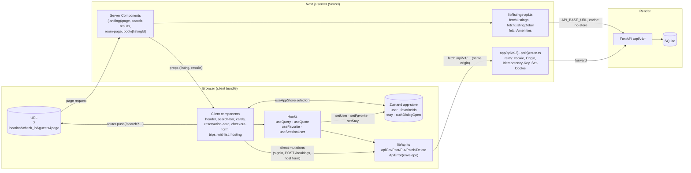

# Frontend data flow

How data moves from a click in the browser to SQLite and back, and which frontend files to read to explain it. Diagrams: [archify/frontend-flow/frontend-flow.html](archify/frontend-flow/frontend-flow.html) (the map) and [archify/booking-sequence/booking-sequence.html](archify/booking-sequence/booking-sequence.html) (one booking, call by call).

## The whole picture

Two ways in, one way out:

1. **Server render (reads)**: a page request runs a Server Component, which calls `lib/listings-api.ts`, which calls FastAPI directly at `API_BASE_URL`. No relay, no cookie. Used for public data: landing shelves, search results, listing detail, checkout's listing.
2. **Browser calls (everything else)**: client code calls `lib/api.ts`, which fetches the relative `/api/v1/...`. The route handler forwards it to FastAPI with the session cookie. Same origin, so no CORS.
3. **State** is never cached business data. The URL holds the search, component state holds form drafts, Zustand holds who is signed in, which hearts are filled, the stay being planned, and whether the auth dialog is open. SQLite holds everything else.

## Read these files, in this order

### 1. The plumbing (read fully, ~250 lines total)

| File | What to be able to say |
|---|---|
| [frontend/app/layout.tsx](../frontend/app/layout.tsx) | Mounts `ThemeProvider` → `AppStoreProvider` → pages, plus the one global `AuthDialog` and `Toaster`. |
| [frontend/app/api/v1/[...path]/route.ts](../frontend/app/api/v1/[...path]/route.ts) | The relay. Forwards 4 headers, copies back `Set-Cookie`, exports one function as GET/POST/PUT/PATCH/DELETE. No logic. |
| [frontend/lib/api.ts](../frontend/lib/api.ts) | Browser fetch wrapper. Turns the error envelope into `ApiError(status, code, message, fields, extra)`. `extra` carries the fresh `quote` on `PRICE_CHANGED`. `apiGet` returns `null` instead of throwing. |
| [frontend/lib/listings-api.ts](../frontend/lib/listings-api.ts) | Server-only reads plus every response type (`ListingSummary`, `ListingDetail`, `Booking`, `Quote`). `fetchListingDetail` maps 404 to `null` so the page can `notFound()`. |
| [frontend/lib/stores/app-store.ts](../frontend/lib/stores/app-store.ts) | The 4 slices and their actions. `clearSession()` on signout. `favoriteIds` is a `Set`, copied on each change so selectors re-render. |
| [frontend/components/providers/app-store-provider.tsx](../frontend/components/providers/app-store-provider.tsx) | Store created in `useState`, not at module level, so two users' server renders never share one. `useAppStore(selector)` only. |

### 2. The hooks (where client reads happen)

| File | What it does |
|---|---|
| [frontend/lib/use-query.ts](../frontend/lib/use-query.ts) | GET hook with a tab-lifetime promise cache keyed by path. `fresh: true` skips the cache (trips, wishlists, hosting: private data). Failed requests are evicted so retry really retries. `forgetCached(prefix)` after posting a review. |
| [frontend/lib/use-quote.ts](../frontend/lib/use-quote.ts) | `POST /listings/{id}/quote`. Cache by `listing|in|out|guests`, plus a `pending` map so the reservation card and the mobile bar share one in-flight call. |
| [frontend/components/auth/use-session.ts](../frontend/components/auth/use-session.ts) | Asks `GET /me` on mount so a refresh directly on a private page works. `checked` drives skeleton vs "log in" prompt. |
| [frontend/components/favorites/use-favorite.ts](../frontend/components/favorites/use-favorite.ts) | Optimistic heart: flip in the store, `PUT`/`DELETE /me/favorites/{id}`, roll back and toast on failure. |
| [frontend/components/rooms/use-reserve.ts](../frontend/components/rooms/use-reserve.ts) | Reads `stay` from the store, gets the quote, `reserve()` pushes `/book/{id}?check_in&check_out&guests`. |

### 3. One file per feature (read the data parts only)

| Feature | Entry file | Calls |
|---|---|---|
| Session restore | [components/layout/header.tsx](../frontend/components/layout/header.tsx) | `GET /me` → `setUser`; when `user.id` changes, `GET /me/favorites/ids` → `setFavorites`; Log out: `POST /auth/signout` → `clearSession()` |
| Log in / sign up | [components/auth/auth-dialog.tsx](../frontend/components/auth/auth-dialog.tsx) | `POST /auth/signin` or `/auth/signup` → `setUser` → close. Field errors come from `ApiError.fields`. |
| Gate private pages | [components/auth/require-user.tsx](../frontend/components/auth/require-user.tsx) | `useSessionUser()`; signed out → Empty state with a button that opens the auth dialog |
| Landing | [app/(landing)/page.tsx](../frontend/app/(landing)/page.tsx) | Server: `fetchListings` once per region shelf |
| Search bar | [components/search/search-bar.tsx](../frontend/components/search/search-bar.tsx), [lib/search-params.ts](../frontend/lib/search-params.ts) | No API. Writes the URL: `router.push(/search?…)`. URL param names equal the `GET /listings` param names. |
| Search results | [components/search/search-results.tsx](../frontend/components/search/search-results.tsx) | Server: `fetchListings(params)` + `fetchAmenities()` in parallel |
| Filters | [components/search/filter-bar.tsx](../frontend/components/search/filter-bar.tsx) | No API. `router.push(/search?${withParams(...)})`, which re-runs the Server Component |
| Map | [components/search/results-map.tsx](../frontend/components/search/results-map.tsx) | Client: `useQuery("/listings/map?…", fresh)` |
| Listing page | [components/rooms/room-page.tsx](../frontend/components/rooms/room-page.tsx) | Server: `fetchListingDetail(id)`; `StaySync` copies URL dates into the store |
| Lazy sections | [calendar-section.tsx](../frontend/components/rooms/calendar-section.tsx), [reviews-section.tsx](../frontend/components/rooms/reviews-section.tsx), [nearby-section.tsx](../frontend/components/rooms/nearby-section.tsx) | `useQuery` on `/availability`, `/reviews?page`, `/listings?location` |
| Reservation card | [components/rooms/reservation-card.tsx](../frontend/components/rooms/reservation-card.tsx) | `useReserve` → `useQuote`; writes guests with `setStay` |
| Checkout | [components/booking/checkout-form.tsx](../frontend/components/booking/checkout-form.tsx) | `useQuote`, then `POST /bookings` with `Idempotency-Key` (one UUID per quote fingerprint). Handles 401, `PRICE_CHANGED`, `DATES_UNAVAILABLE`. |
| Confirmation | [components/booking/confirmation-view.tsx](../frontend/components/booking/confirmation-view.tsx) | `useQuery("/bookings/{id}", fresh)` |
| Trips | [components/trips/trips-view.tsx](../frontend/components/trips/trips-view.tsx), [review-button.tsx](../frontend/components/trips/review-button.tsx) | `GET /me/bookings?phase&page` (fresh); `POST /listings/{id}/reviews` then `forgetCached` |
| Wishlists | [components/favorites/wishlist-view.tsx](../frontend/components/favorites/wishlist-view.tsx) | `GET /me/favorites?page` (fresh); remove/undo with `DELETE`/`PUT`, kept in sync with `setFavorite` |
| Profile | [components/profile/about-me.tsx](../frontend/components/profile/about-me.tsx), [lib/profile-links.ts](../frontend/lib/profile-links.ts) | `PATCH /me` → `setUser`; counts from `/me/bookings` and `/host/listings`. Tabs live in `?tab=`. |
| Host dashboard | [components/hosting/dashboard-view.tsx](../frontend/components/hosting/dashboard-view.tsx) | `GET /host/listings?include_archived` (fresh); archive = `DELETE /host/listings/{id}` |
| Host form | [components/hosting/listing-form.tsx](../frontend/components/hosting/listing-form.tsx) | `GET /amenities`; `POST /host/listings` or `PATCH /host/listings/{id}`; photo upload: `POST /host/uploads/sign`, then the browser posts straight to Cloudinary |
| Reservations | [components/hosting/reservations-view.tsx](../frontend/components/hosting/reservations-view.tsx) | `GET /host/bookings?phase&page&listing_id` (fresh) |

## Who touches the store

| Slice | Written by | Read by |
|---|---|---|
| `user` | header (`GET /me`), auth-dialog, use-session, about-me (`PATCH /me`), `clearSession` | header menu, use-favorite, require-user, checkout |
| `favoriteIds` | header (`/me/favorites/ids`), use-favorite (optimistic), wishlist-view | every heart via `s.favoriteIds.has(id)`, about-me count |
| `stay` | stay-sync (from URL), calendar-section, reservation-card | use-reserve, calendar-section |
| `authDialogOpen` | `openAuthDialog()` from header, use-favorite, checkout (on 401), require-user | auth-dialog |

## Three traces to be able to walk through

**Search.** Type "Goa" and pick dates → `search-bar` builds `URLSearchParams` → `router.push("/search?location=Goa&check_in=…")` → Next renders `search/page.tsx` → `SearchResults` awaits `searchParams` → `fetchListings` calls `GET {API_BASE_URL}/api/v1/listings?location=Goa&…` with `no-store` → cards render. Back/refresh/share work because the URL is the state.

**Heart.** Click the heart → `useFavorite.toggle` → signed out? `openAuthDialog()` and stop → otherwise `setFavorite(id, true)` (every heart for that id fills at once) → `apiPut("/me/favorites/{id}")` → relay forwards the cookie → FastAPI 204 → toast. On failure: `setFavorite(id, false)` and an error toast.

**Booking.** See the sequence diagram. Pick dates → `setStay` → `useQuote` posts the quote → Reserve pushes `/book/{id}?…` → server fetches the listing, client re-uses the cached quote → Confirm posts `/bookings` with `Idempotency-Key` → FastAPI runs one `INSERT … SELECT … WHERE NOT EXISTS overlap` → 201 → `router.push("/bookings/{id}/confirmation")`, which fetches `/bookings/{id}` fresh.

## Likely interview questions

- **Why the relay instead of calling FastAPI from the browser?** Same origin: the HttpOnly session cookie is first-party, no CORS config, and `API_BASE_URL` never ships to the browser.
- **Why do Server Components skip the relay?** They run on the server already; going through the relay would be a second hop to the same place. They only read public data, so they need no cookie.
- **Why not React Query?** Two small hooks cover it: a path-keyed cache with retry and a `fresh` flag. Nothing needs background refetch or mutations cache invalidation beyond `forgetCached`.
- **Why Zustand at all?** Hearts on cards, the listing page and the wishlist must agree instantly, and the reservation card, calendar and mobile bar must share one stay. Prop drilling across the layout would be worse.
- **Why is the store per provider?** A module-level store would be shared by every request on the server.
- **What stops a double booking from a double click?** The button stays `pending`, and the same `Idempotency-Key` is reused for the same quote, so the API returns the existing booking.
